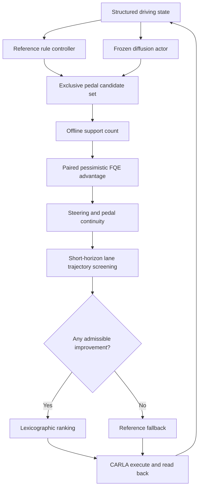

# Uncertainty-aware Stable Policy Improvement for Autonomous Driving

**USPI · Diffusion-assisted Offline Policy Improvement with Reference-relative Stability Constraints**

USPI 是面向结构化自动驾驶状态的离线强化学习策略改进框架。它以已有的确定性驾驶控制器为参考策略，以冻结的 Diffusion-QL Actor 提供多样化动作候选，以多目标 Fitted Q Evaluation (FQE) 集成网络估计相对长期收益，再联合考虑数据支持度、预测不确定性、控制连续性以及局部车道跟踪稳定性，筛选并执行候选动作。

**Research status.** 本仓库包含已开展正式闭环评估的 RCDPI V1，以及在其失败模式基础上设计并实现的 USPI（新版）。USPI 仅进行了无仿真器的代码单元测试，尚未开展新的 CARLA 闭环实验。历史实验结果不可视作 USPI 的性能，本文所述改进为算法机制和研究假设，不是经验性能或安全保证。当前系统仅用于仿真研究，不用于真实车辆控制。

## 1. Motivation and research contributions

离线 RL 允许从已有的驾驶数据学习控制策略，而不必在线探索潜在危险的状态动作空间。Diffusion-QL 通过条件扩散模型描述复杂的行为分布，再借助价值函数引导策略优化。然而，在需要连续控制的驾驶系统中，单步动作获得较高的预测价值，并不意味着执行该动作后能维持稳定的车辆轨迹。一方面，离线 Critic 会受到分布外动作和共享模型误差影响；另一方面，逐步独立采样的动作可能相互冲突或突然变化，破坏闭环控制稳定性。

EasyCarla 已经提供自车速度、车道信息、局部参考航点和前车距离等结构化观测，因此基于比例反馈的 Rule-based Policy 可以具有很强的驾驶性能。在前期 RCDPI V1 中，我们利用该控制器作为 Reference Policy，训练多目标 FQE 集成，并在离散候选集合中进行价值约束的策略改进。100 回合结果表明：RCDPI V1 消除了油门制动重叠，但与 Rule 相比，回报和进展下降，越界与平面 jerk 增加。这个现象提示：仅对预测的单步参考优势设限，未必足以维持闭环稳定性。

USPI 由此提出三个**设计层面的研究贡献**：

1. **不确定性感知的参考相对价值估计。** 在每个 FQE 成员内计算候选与参考动作的配对优势，而非直接比较两个独立的绝对价值估计；以最差成员优势和成员分歧联合构建悲观评分，统一约束回报、路线进展、安全代价与运动 jerk。该设计减少共同价值偏移的影响，并显式惩罚成员间不一致，但不能消除共同估计偏差。
2. **显式控制连续性与参考相对局部轨迹筛选。** 在执行前基于实际上一控制命令限制转向和净踏板变化，并用短时运动学自行车代理模型估计候选的中心线偏离与航向误差，要求非参考动作既满足绝对代理边界，又不显著恶化参考轨迹。相对于将连续性作为软排序项，USPI 将其作为非参考候选的准入条件。
3. **数据支持约束下的生成式保守策略改进。** 将离线数据支持度、物理动作可行性、四目标悲观优势和局部稳定性筛选组成统一的候选可行集合，在集合内进行确定性多目标排序，无可接受改进时执行参考动作。Actor 与 FQE 均可复用 V1 已有 checkpoint，无需额外训练动力学网络；新增计算发生在推理时。尚需后续消融来分离各模块与扩散候选的独立贡献。



## 2. Problem formulation

驾驶任务表示为带多目标反馈的 MDP $\mathcal M=(\mathcal S,\mathcal A,P,r,c,\gamma)$。状态按照原实验的固定顺序展平：

$$s_t=[s_t^{ego},s_t^{lane},s_t^{lidar},s_t^{nearby},s_t^{waypoint}]\in\mathbb R^{307}.$$

| Observation | Size | Meaning |
|---|---:|---|
| Ego | 9 | 世界坐标 x/y、yaw（rad）、速度、yaw rate、世界坐标平面加速度、前车距离、相对速度 |
| Lane | 2 | 车道宽度、到车道中心的距离 |
| LiDAR | 240 | 原始结构化 LiDAR 特征 |
| Nearby | 20 | 5 辆邻近车辆，各 4 个局部状态量 |
| Waypoint | 36 | 12 个航点，各为局部 x/y 与相对 yaw |

控制周期 $\Delta t=0.1\,\mathrm{s}$。动作 $a_t=(u_t,\delta_t,b_t)$ 分别表示归一化油门、转向与制动，其中 $u,b\in[0,1]$，$\delta\in[-1,1]$。原环境奖励和安全代价为：

$$r_t=r_v(v_t)-d_{lane,t}-0.5|a_{y,t}|-I_{d_{front}>10,\;v<0.1}-100I_{col}-100I_{off},$$

$$r_v(v)=\begin{cases}v,&v\leq8,\\-(v-8),&v>8,\end{cases}\qquad c_t=20I_{col}+20I_{off}+\frac{[v_t-8]_+}{8}.$$

这里 $a_y$ 是历史环境使用的世界坐标 y 加速度分量，不是严格的车体横向加速度。任务不是端到端视觉驾驶，也不包括完整全局导航规划；参考航点直接由地图提供。

此外使用实际状态转移定义有符号路线进展与平面 jerk：

$$p_t=(x_{t+1}-x_t)\cos\psi_{lane,t}+(y_{t+1}-y_t)\sin\psi_{lane,t},$$

$$j_t=\frac{\|\mathbf a_{xy,t+1}-\mathbf a_{xy,t}\|_2}{\Delta t}.$$

进展的车道方向由当前 ego yaw 与第一个参考航点相对 yaw 相加；无有效航点时原训练程序将进展置零。令 $g_t=(r_t,p_t,c_t,j_t)$，前两项越大越好，后两项越小越好。学习时使用折扣累积信号，报告时使用未折扣回报、累计进展和成本、逐回合平均 jerk 等指标，两者并不相同。

## 3. Reference policy and diffusion candidates

参考策略 $\pi_0$ 是固定的局部航点跟踪 + 比例速度反馈 + 前车距离制动控制器。取第 4 个参考航点 $(x_w,y_w)$（下标 3），其航向误差为 $\theta=\operatorname{atan2}(y_w,\max(x_w,0.1))$，控制律为：

$$\delta_0=\operatorname{clip}(1.5\theta,-0.8,0.8),\quad u_0=\operatorname{clip}(0.25(8-v),0,0.8),\quad b_0=\operatorname{clip}(0.35(v-8),0,1).$$

若 $0<d_{front}<7$ m，则置 $u_0=0$ 且 $b_0\leftarrow\max(b_0,0.6)$。它不是完整 PID 或标准 Pure Pursuit；在结构化任务中它直接利用正确车道几何与速度目标，因此是强参考而非刻意弱化的基线。

扩散 Actor 使用原始 Diffusion-QL 的五步 VP 扩散架构。对离线动作 $a$，前向加噪为：

$$a^{(k)}=\sqrt{\bar\alpha_k}a+\sqrt{1-\bar\alpha_k}\epsilon,\quad\epsilon\sim\mathcal N(0,I),\quad\bar\alpha_k=\prod_{l=1}^{k}(1-\beta_l).$$

噪声预测网络通过条件去噪损失学习动作分布：

$$\mathcal L_{BC}=\mathbb E_{s,a,k,\epsilon}\|\epsilon-\epsilon_\theta(a^{(k)},s,k)\|_2^2.$$

原始 Actor 目标为 $\mathcal L_{BC}+\eta\mathcal L_{QL}$，其中 $\mathcal L_{QL}$ 是带 Q 尺度归一化的负价值目标。训练 Critic 用双 Q 最小值构造目标；实现以归档的 `upstream_snapshot/example/agents/ql_diffusion.py` 为准。历史 strong DQL 使用 $\eta=1$、200,000 次更新。USPI 冻结其 Actor，不重训或修改离线动作标签。

每步从 Actor 采样 23 个动作 $\tilde a_i$。对每个有限候选，先执行分量限幅，再构造互斥踏板的 drive/brake 两个版本：

$$a_i^{drive}=(\tilde u_i,\tilde\delta_i,0),\qquad a_i^{brake}=(0,\tilde\delta_i,\tilde b_i).$$

另外加入参考动作、沿参考转向滑行、沿参考转向完全制动、上一实际执行动作（若合法）。去重后候选集合 $\mathcal C(s_t)$ 最多包含 50 个动作，参考动作固定在索引 0，且每个可执行候选满足 $ub=0$。过去数据中同时踩油门和制动的记录仍保留真实动作与真实后继；不得修改历史动作后假装它们产生了相同状态转移。

## 4. Offline data support and reference FQE

### 4.1 Support screening

离线 Q 网络难以可靠评价数据覆盖不足的候选。我们使用原 RCDPI 的训练集粗粒度计数表，将状态和动作映射为离散上下文索引 $B(s,a)$。六个维度分别是速度、前车距离、参考转向、踏板模式、踏板强度及实际转向，分箱数量为 $6\times4\times3\times4\times4\times5=5760$。

$$N_{\mathcal D}(s,a)=\sum_{(s_i,a_i)\in\mathcal D_{train}}I\{B(s_i,a_i)=B(s,a)\}.$$

非参考动作仅当 $N_{\mathcal D}\geq n_{min}$ 才有资格进入后续筛选，默认 $n_{min}=5$。该计数仅用于剔除明显缺少覆盖的动作，不是密度估计或严格的分布内证明；参考动作始终保留为回退。分箱边界见 `da_control_support.py`。

### 4.2 Multi-objective reference policy evaluation

对参考策略 $\pi_0$，第 $k$ 个信号的长期价值定义为：

$$Q_k^{\pi_0}(s,a)=\mathbb E\left[\sum_{h=0}^{\infty}\gamma^h g_{k,t+h}\mid s_t=s,a_t=a,\ a_{t+h}=\pi_0(s_{t+h}),h\geq1\right].$$

训练 $M=3$ 个独立初始化的 FQE 成员，每个成员从训练集整条轨迹 bootstrap 后采样真实转移。令 $d_t$ 为记录的终止标记，$\sigma_k$ 为训练样本的一步信号 RMS（下限 0.1），$q_{m,k}$ 为归一化价值，物理单位的价值为 $\widehat Q_{m,k}=\sigma_k q_{m,k}$。使用冻结/慢更新目标网络 $q^-_{m,k}$，Bellman 目标为：

$$y_{m,k}=\frac{g_{k,t}}{\sigma_k}+\gamma(1-d_t)q^-_{m,k}(s_{t+1},\pi_0(s_{t+1})),$$

$$\mathcal L_m=\frac{1}{4}\sum_{k=1}^4\mathbb E[(q_{m,k}(s_t,a_t)-y_{m,k})^2],\qquad \theta^-_m\leftarrow(1-\tau)\theta^-_m+\tau\theta_m.$$

状态 yaw 以 sin/cos 编码得到 308 维特征，再使用训练集均值和标准差归一化。模型宽度 256，学习率 $3\times10^{-4}$，$\gamma=0.99,\tau=0.005$，batch=256。每成员 66,667 次更新，合计 200,001 次成员更新。它们不是 200,001 次共享网络训练，也不等价于 DQL 的计算成本；完整 USPI 还依赖之前的 200k Actor 训练。

FQE 估计的是“当前候选动作，后续参考策略”的价值，而非 USPI 自身的 Q。参考动作在离线数据中也可能缺少覆盖，终止标记包括超时记录，集成成员存在共同偏差。这些限制决定了后续约束只能约束模型预测。

## 5. USPI: Uncertainty-aware stable policy improvement

### 5.1 Paired conservative advantage

原 RCDPI V1 要求三个成员各自预测 Reward / Progress 不下降、Cost 不增加，却只把 Jerk 用于排序。USPI 先将四个信号统一成“正值代表改进”的方向 $\mathbf z=(1,1,-1,-1)$，在同一 FQE 成员内部计算候选与参考动作的归一化相对优势：

$$A_{m,k}(s,a)=\frac{z_k[\widehat Q_{m,k}(s,a)-\widehat Q_{m,k}(s,a_0)]}{\sigma_k}.$$

配对能够消除两个动作共有的加性价值偏移；不会消除动作相关偏差。令 $\bar A_k$ 为成员均值，$u_k$ 为总体标准差：

$$\bar A_k=\frac1M\sum_m A_{m,k},\qquad u_k=\sqrt{\frac1M\sum_m(A_{m,k}-\bar A_k)^2}.$$

USPI 使用 **worst-member minus disagreement** 悲观评分，而不是直接称为具有覆盖率保证的置信下界：

$$L_k(s,a)=\min_m A_{m,k}(s,a)-\lambda_u u_k(s,a),\quad\lambda_u\geq0.$$

默认 $\lambda_u=1$。因此 $L_k\leq\min_m A_{m,k}$，比 V1 成员一致性条件更严格，且不会像单独使用 $\bar A-\lambda_u u$ 一样在某些分布下放宽最差成员约束。非参考候选要求四个通道全部满足 $L_k\geq\epsilon$（默认 $\epsilon=0$），并至少一项 $L_k>10^{-6}$，避免无信息价值相等时无意义地偏离参考。特别是 $L_{jerk}\geq0$ 从排序偏好升级为硬准入条件。该评分只反映集成分歧代理，不是统计置信区间；系数没有通过新实验标定。

### 5.2 Lateral and longitudinal continuity constraints

单步动作可行不等于相邻动作连续。将踏板合并为净纵向命令 $w(a)=u-b$，使用 CARLA 上一步真实执行回读 $a_{t-1}^{exec}$（初始步使用当前参考）作为锚点：

$$D_\delta(a)=|\delta-\delta_{t-1}^{exec}|,\qquad D_w(a)=|w(a)-w(a_{t-1}^{exec})|.$$

非参考动作需同时满足绝对变化约束及参考相对变化约束：

$$D_\delta(a)\leq\min(\kappa_\delta,D_\delta(a_0)+\xi_\delta),$$

$$D_w(a)\leq\min(\kappa_w,D_w(a_0)+\xi_w).$$

默认 $\kappa_\delta=0.08,\kappa_w=0.12,\xi_\delta=0.02,\xi_w=0.04$，均为每个 0.1 s 步长下的归一化命令幅度，不是物理转角速度或车辆加速度约束。若参考策略已经触发前车 7 m 制动条件，所有非参考动作必须满足 $u=0,b\geq b_0$。参考回退不经过连续性筛选，以免限制紧急制动或规则控制必要的纠偏。连续性筛选发生在执行前，不对选出的动作再做未评价的后处理。

### 5.3 Reference-relative local trajectory screening

FQE 长期价值不能准确描述每一次局部车道偏离，故引入一个低成本、无需额外训练的运动学代理。以当前车辆局部坐标为原点，初始 $\mathbf p_0=(0,0),\psi_0=0,v_0=v_t$。将候选控制固定执行 $H=5$ 个预测步（0.5 s），采用无侧滑的自行车近似：

$$\alpha(a)=k_u u-k_b b,\quad v_{h+1}=\max(0,v_h+\Delta t\alpha(a)),\quad \bar v_h=(v_h+v_{h+1})/2,$$

$$\phi(a)=\phi_{max}\delta,\quad \Delta\psi_h=\frac{\Delta t\bar v_h}{\ell}\tan\phi(a),\quad\psi_{h+1}=\psi_h+\Delta\psi_h,$$

$$\mathbf p_{h+1}=\mathbf p_h+\Delta t\bar v_h\begin{bmatrix}\cos(\psi_h+\Delta\psi_h/2)\\\sin(\psi_h+\Delta\psi_h/2)\end{bmatrix}.$$

默认轴距 $\ell=2.875$ m，最大前轮代理转角 $\phi_{max}=0.5$ rad，油门与制动代理加速度增益分别为 $k_u=3,k_b=6\,\mathrm{m/s^2}$。这些是设计参数，并未从当前 CARLA 车辆动力学重新辨识。

参考航点组成分段线性中心线 $\Gamma$。对任意预测位置 $\mathbf p_h$ 和线段端点 $\mathbf q_i,\mathbf q_{i+1}$，用投影参数计算最近距离：

$$\rho_i=\operatorname{clip}\left(\frac{(\mathbf p_h-\mathbf q_i)^\top(\mathbf q_{i+1}-\mathbf q_i)}{\|\mathbf q_{i+1}-\mathbf q_i\|_2^2},0,1\right),$$

$$d(\mathbf p_h,\Gamma)=\min_i\|\mathbf p_h-[\mathbf q_i+\rho_i(\mathbf q_{i+1}-\mathbf q_i)]\|_2.$$

令 $i_h$ 为最近线段索引，$\psi_{i_h}$ 为该线段的方向；取整个预测窗口的最大中心线距离及最大绝对环绕航向误差：

$$E_d(a)=\max_{1\leq h\leq H}d(\mathbf p_h,\Gamma),\quad E_\psi(a)=\max_{1\leq h\leq H}|\operatorname{wrap}(\psi_h-\psi_{i_h})|.$$

同样对参考动作 $a_0$ 执行代理 rollout。非参考动作必须满足：

$$E_d(a)\leq\min\{W/2-m_{lane}, E_d(a_0)+\epsilon_d\},\qquad E_\psi(a)\leq E_\psi(a_0)+\epsilon_\psi.$$

其中 $W$ 为当前车道宽度，$m_{lane}=0.25$ m，$\epsilon_d=0.05$ m，$\epsilon_\psi=0.03$ rad。若航点缺失、中间填零、车道宽度无效或轨迹超出已知末段，拒绝非参考候选。此条件检查的是代理车辆中心点，而非完整车身包络；未建模其他车辆运动、轮胎动力学、坡度或交通信号，不能称为形式化安全验证或 Lyapunov 稳定性证明。适用于当前低速结构化车道跟踪研究场景。

### 5.4 Unified feasible set and action ranking

将上述条件组合成非参考候选可行集合：

$$\mathcal F_t=\{a\in\mathcal C_t\setminus\{a_0\}:\ \text{physical}(a),\ N_{\mathcal D}\geq n_{min},\ \forall k:L_k\geq\epsilon,\ \exists k:L_k>\epsilon_{imp},\ \text{continuity}(a),\ \text{trajectory}(a)\}.$$

在可行集合内，采用确定性的字典序最大化，依次比较悲观 Cost 改进、Jerk 改进、Progress 改进和 Reward 改进：

$$a_t=\begin{cases}\underset{a\in\mathcal F_t}{\operatorname{lexmax}}(L_c,L_j,L_p,L_r),&\mathcal F_t\ne\varnothing,\\a_0,&\mathcal F_t=\varnothing.\end{cases}$$

排序同值时按候选索引打破平局。执行后从 CARLA 回读实际命令并更新锚点；每个 episode reset 清空历史。全部筛选均在非参考动作上实施，参考是无条件可用的回退而非经过形式安全认证的动作。`actions.csv` 记录 `gate_support_count`、`gate_advantage_count`、`gate_continuity_count`、`gate_trajectory_count`、选中动作源及轨迹代理误差，用于后续诊断。四个 `*_improvement` 字段为悲观评分乘回对应 RMS 后的报告单位；不能与 V1 的最差成员差值混为相同定义。

### 5.5 Theoretical scope

若在理想条件下有精确的参考优势，且每个状态选择的动作对每项方向统一后的折扣信号优势均非负，则对相应标量目标可由性能差异恒等式得到：

$$J_k(\pi)-J_k(\pi_0)=\frac1{1-\gamma}\mathbb E_{s\sim d^\pi_\gamma,a\sim\pi}[A_k^{\pi_0}(s,a)]\geq0,$$

这里 $d^\pi_\gamma$ 是归一化折扣状态访问分布，成本与 jerk 需先反号；若策略依赖上一命令，可在包含动作历史的扩展状态空间表述，且优势仍须对扩展状态成立。USPI 的 FQE 并非精确价值，$L_k$ 未被证明是真实优势下界，局部轨迹为代理模型，因此上述恒等式只说明设计动机，**不构成 USPI 的真实收益不下降证明**。实际评价的未折扣回报、事故率、平均 jerk 亦不由上述折扣结论直接保证。

## 6. Historical experimental evidence (RCDPI V1 only)

下表来自本项目正式实验中用户提供的服务器终端汇总（两种方法各 100 Episodes，seed 1000–1099）。DQL 最终本轮数据文件未提供到本仓库，故不填入数值。先前独立 DQL 100 回合汇总单独保存在 `results/dql_historical_summary_100.csv`。

| Metric | RCDPI V1 | Rule | Preferred |
|---|---:|---:|---|
| Return | 5207.62613 | 5607.84415 | ↑ |
| Route progress (m) | 576.94890 | 592.78075 | ↑ |
| Safety cost | 4.20096 | 2.40000 | ↓ |
| Mean planar jerk (m/s³) | 12.17710 | 3.08066 | ↓ |
| Collision rate | 6% | 9% | ↓ |
| Off-road rate | 15% | 3% | ↓ |
| Mean speed (km/h) | 23.23217 | 23.23506 | context |
| Executed pedal overlap | 0% | 0% | ↓ |
| Steering variation | 0.03617 | 0.01033 | ↓ |
| Longitudinal variation | 0.04472 | 0.00320 | ↓ |
| Inference (ms) | 8.21427 | 0.05737 | ↓ |

V1 的 90,718 个动作中，79.388% 来自规则策略，16.420% 来自 Diffusion 候选，其余主要来自 Hold。数据支持 RCDPI 消除了双踏板冲突，但未实现相对 Rule 的多目标改进。越界和运动平滑性退化是 USPI 新增机制的直接研究动机；不能据此断定 Diffusion 或 Hold 是退化的因果来源。没有统计显著性检验，也没有 USPI 新结果。完整来源见 [results/README.md](results/README.md)。

## 7. Repository and server configuration

下列配置流程是原实验部署的整理版，附带可执行脚本，详细故障排查见 [docs/SERVER_SETUP.md](docs/SERVER_SETUP.md)。代码文件保留历史 V1 命名以便复用 checkpoint；`evaluate_uspi.py --mode uspi` 才是新版算法。

| Historical environment | Value |
|---|---|
| GPU | NVIDIA RTX 4090, reported 49,140 MiB |
| NVIDIA driver | 570.195.03 (driver-reported CUDA 12.8) |
| Python | 3.11.8 |
| PyTorch | 2.2.1+cu121 |
| CARLA | 0.9.16 Linux + cp311 Python wheel |
| Gym / NumPy | 0.26.2 / 1.24.4 |
| Map / rendering | Town03 / Vulkan Epic Offscreen |
| Dataset | Town03 HDF5, ~2.76 GB, 1,114,451 transitions (historically reported) |
| Split | complete trajectories, seed 2026; reported train/cal/test 890845/128590/95016 |
| Training | seed 42, DQL 200k + FQE 200001 member updates |
| Evaluation | 100 episodes/policy, 20 background vehicles, max 1000 steps, seed 1000–1099 |

### 7.1 Install environment and code

CARLA 0.9.16 must be obtained from [CARLA releases](https://github.com/carla-simulator/carla/releases/tag/0.9.16) separately. Upstream EasyCarla-RL is [silverwingsbot/EasyCarla-RL](https://github.com/silverwingsbot/EasyCarla-RL). This repository includes exact archived environment and agent files from the V1 analysis archive, not the entire upstream checkout. The original upstream commit was not captured; the installer records the newly resolved upstream commit for missing support files. For strict reproduction, pin `EASYCARLA_REF` to your original known commit if available.

```bash
# From this repository, using a Python 3.11 venv or GPU container
export CARLA_ROOT=/hy-tmp/easycarla-work/CARLA_0.9.16
bash scripts/install_python.sh
# Choose a NEW workspace, never overwrite existing experiments
bash scripts/install_workspace.sh /hy-tmp/easycarla-work/USPI-EasyCarla-RL
cd /hy-tmp/easycarla-work/USPI-EasyCarla-RL
python -m unittest discover -s tests -v
```

### 7.2 Dataset and checkpoints

```bash
mkdir -p data logs da_runs demo_runs
wget -c 'https://huggingface.co/datasets/silverwingsbot/easycarla/resolve/main/easycarla_offline_dataset.hdf5' \
  -O data/easycarla_offline_dataset.hdf5
```

数据、模型权重和大体积评估轨迹不随 Git 仓库发布。若保留原服务器，直接使用原有 `da_runs/strong42_eta1/dql_epoch0200.pth` 和 `da_runs/rcdpi42/critics.pt`（复制至新工作目录或通过绝对路径引用）。没有 checkpoint 时，可按以下命令复现离线训练；**不是本次发布的必需步骤**。

```bash
nohup bash scripts/train_offline.sh > logs/uspi_train_pipeline.log 2>&1 < /dev/null &
echo $! > logs/uspi_train_pipeline.pid
```

### 7.3 Start CARLA and Town03

配置非 root 用户、可用的 NVIDIA EGL Vulkan ICD 后（见服务器文档），启动 CARLA：

```bash
nohup runuser -u carlasim -- env \
  CARLA_ROOT="$CARLA_ROOT" \
  CARLA_VULKAN_ICD=/etc/carla-vulkan/nvidia_egl_icd.json \
  bash "$PWD/scripts/start_carla.sh" > logs/carla_server.log 2>&1 < /dev/null &
echo $! > logs/carla_server.pid
python scripts/check_carla.py
# Only when no other CARLA client controls the world:
python scripts/prepare_town03.py --confirm-idle
```

### 7.4 Optional evaluation (not run for USPI)

若未来要验证新版，只需使用已有权重与新的空输出目录。不要与正式评估、Demo 或其他 CARLA 控制器同时运行。

```bash
python -u evaluate_uspi.py --mode uspi \
  --checkpoint da_runs/strong42_eta1/dql_epoch0200.pth \
  --control-checkpoint da_runs/rcdpi42/critics.pt \
  --uspi-config configs/uspi.json --out da_runs/uspi42/eval_uspi \
  --episodes 100 --seed 1000 --vehicles 20 --steps 1000 --town Town03 --device cuda
```

可选三方法完整对比（与单方法命令二选一，使用新目录）：

```bash
CRITICS=da_runs/rcdpi42/critics.pt OUT=da_runs/uspi42_fresh \
  nohup bash scripts/evaluate_three.sh > logs/uspi42_pipeline.log 2>&1 < /dev/null &
echo $! > logs/uspi42_pipeline.pid
```

原 V1 重现使用 `evaluate_da_control.py --mode da_control`，或 `evaluate_uspi.py --mode da_control`；Rule 和 DQL 分别使用 `--mode rule` 与 `--mode dql`。DQL 必须提供 Actor checkpoint，Rule 不需要模型。所有正式输出使用独立新目录。配置阈值见 `configs/uspi.json`，均未开展新闭环标定。

### 7.5 Dashboard and live demo

历史比较 Dashboard（V5）采用 8081 端口，视频源使用内部 8080，三种正式结果在同一页面。它读取 `da_runs/rcdpi42` 的历史 V1 数据，而不将 USPI Demo 标记为正式结果。先复制历史完整运行目录与相关日志（未随本包提供），也可从已有 FQE checkpoint 生成 Reward RMS：

```bash
python scripts/reward_scale.py da_runs/rcdpi42/critics.pt
nohup python -u research_monitor.py --port 8081 --video-port 8080 \
  > logs/research_monitor.log 2>&1 < /dev/null &
echo $! > logs/research_monitor.pid
```

实际驾驶 Demo 复用真实控制策略，仅向视频服务额外发布车前 RGB 与 35 m 鸟瞰 RGB；默认 10 episodes，输出单独的 `demo_runs/`。下面是**历史 RCDPI V1** 展示命令，而非新版结果：

```bash
nohup python -u rcdpi_live_demo.py --mode da_control --confirm-idle \
  --checkpoint da_runs/strong42_eta1/dql_epoch0200.pth \
  --control-checkpoint da_runs/rcdpi42/critics.pt \
  --episodes 10 > logs/rcdpi_live_demo.log 2>&1 < /dev/null &
echo $! > logs/rcdpi_live_demo.pid
```

将 `--mode da_control` 改为 `--mode uspi --uspi-config configs/uspi.json` 可在未来测试新策略，但本次不启动。第三个视图是实际世界 XY 轨迹叠加，不是三车同场真实渲染。当前仓库重建了视频与 V5 比较接口，未在新的远程实例上验证摄像头/浏览器视频传输。监控为只读，退出 `tail -F` 不停止实验。将服务器 8081 转发到本地 8081 后访问 `http://127.0.0.1:8081/`；8080 不需要公开。

## 8. Files and checks

| File | Function |
|---|---|
| `uspi_policy.py`, `configs/uspi.json` | New uncertainty/stability-aware inference and defaults |
| `da_control_policy.py`, `da_control_model.py`, `da_control_rule.py`, `da_control_support.py` | Archived V1 candidate generation, FQE, rule and support |
| `train_dql_v2.py`, `train_da_control.py`, `train_da_dql.py` | Offline model training and dataset loader |
| `evaluate_da_control.py`, `evaluate_uspi.py` | Original and extended evaluator |
| `upstream_snapshot/` | Archived CARLA environment and DQL agent sources |
| `dashboard/`, `rcdpi_live_demo.py` | Comparative monitoring and independent demonstration |
| `scripts/`, `docs/SERVER_SETUP.md` | Setup, map recovery, training, evaluation and publication |
| `tests/` | CPU-only deterministic software tests |
| `results/` | Historical results and provenance |

```bash
python -m unittest discover -s tests -v
python -m compileall -q .
```

Unit tests cover candidate exclusivity, paired pessimistic advantage, rejection of worse jerk, unsupported candidates, nonfinite reference value, absent route, emergency braking, steering continuity, local rollout and lane margin fallback. They are not driving experiments. No new training, CARLA validation or safety certification has been performed for USPI. The rollout proxy, numerical defaults, FQE calibration and diffusion-specific benefit require future validation if research resumes.

## 9. Acknowledgements and license

This work extends [EasyCarla-RL](https://github.com/silverwingsbot/EasyCarla-RL) by SilverWings and reuses the original [Diffusion-QL](https://github.com/twitter/diffusion-rl) implementation by Wang et al. (ICLR 2023, *Diffusion Policies as an Expressive Policy Class for Offline Reinforcement Learning*). CARLA is an external simulator (Dosovitskiy et al., CoRL 2017). FQE is a standard offline policy evaluation technique; ensemble pessimism and kinematic bicycle models are established building blocks, not individually claimed as novel. The contribution here is their reference-relative integration for generation-assisted driving policy improvement.

See [LICENSE](LICENSE) and [NOTICE](NOTICE). CARLA, dataset and model checkpoints are not redistributed. This repository is intended for academic simulation research.
